# CNAS: Campus Navigation & Alert System

CNAS (shown to users as **TCC NAV**) helps people find their way around **Tagoloan Community College** and warns
everyone on campus when there is an emergency. It gives walking directions to any building or room, and it sends
emergency alerts that take over the screen of every phone and open browser. The project scope is the College of
Information Technology. It runs as a website and as an Android/iOS app.

**Who uses it**

- **Students:** directions, their class schedule (read from their COR), saved places, emergency alerts, "I'm safe".
- **Faculty:** the same, plus "My classes". Faculty the admin trusts can send and end emergency alerts.
- **Staff:** the faculty portal without the teaching parts. Trusted staff can send alerts too.
- **Administrator:** everything above, plus the admin console (alerts, concerns, accounts, campus map, settings).
- **Guests:** the campus map, directions and campus alerts. No account is needed.

## Screenshots

All screenshots use made-up demo people and data.

**Website**

| | |
| --- | --- |
| 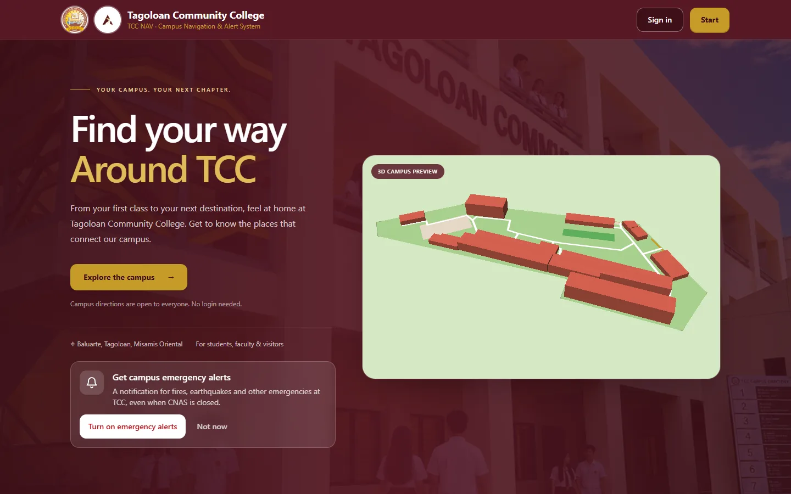<br>Landing page | 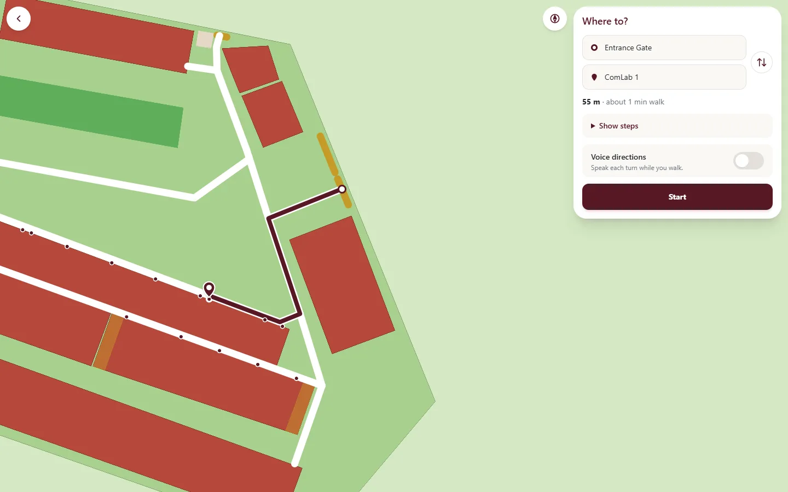<br>Walking directions (/navigate) |
| 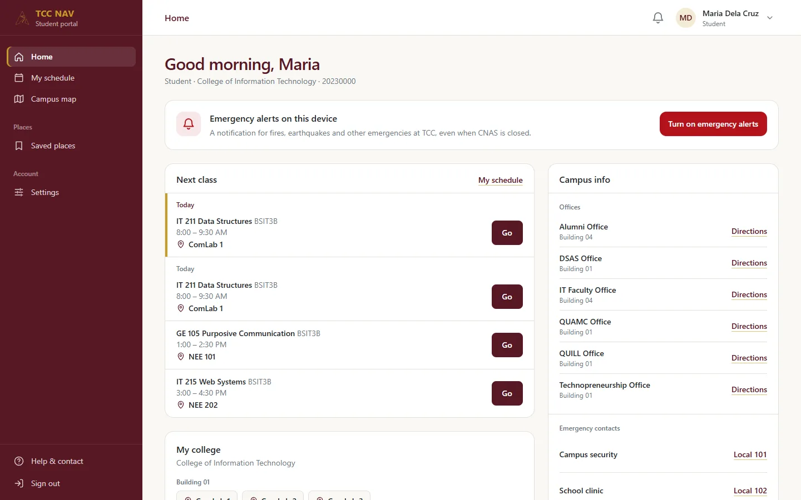<br>Student portal: Home | 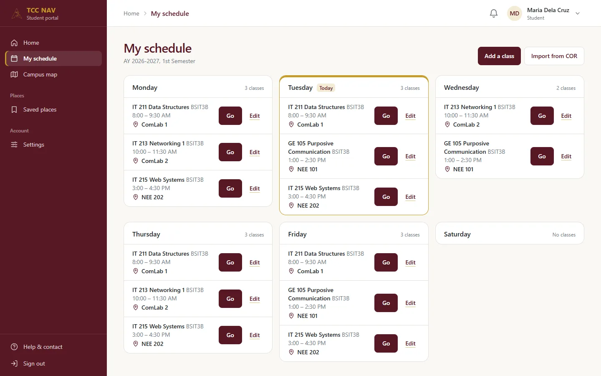<br>Student portal: My schedule |
| 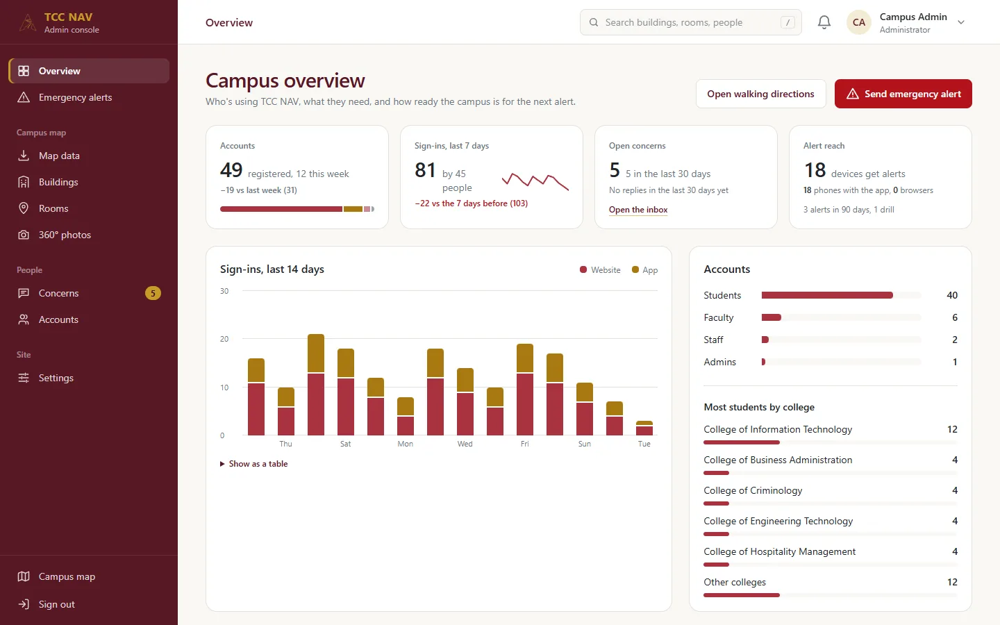<br>Admin: Overview | 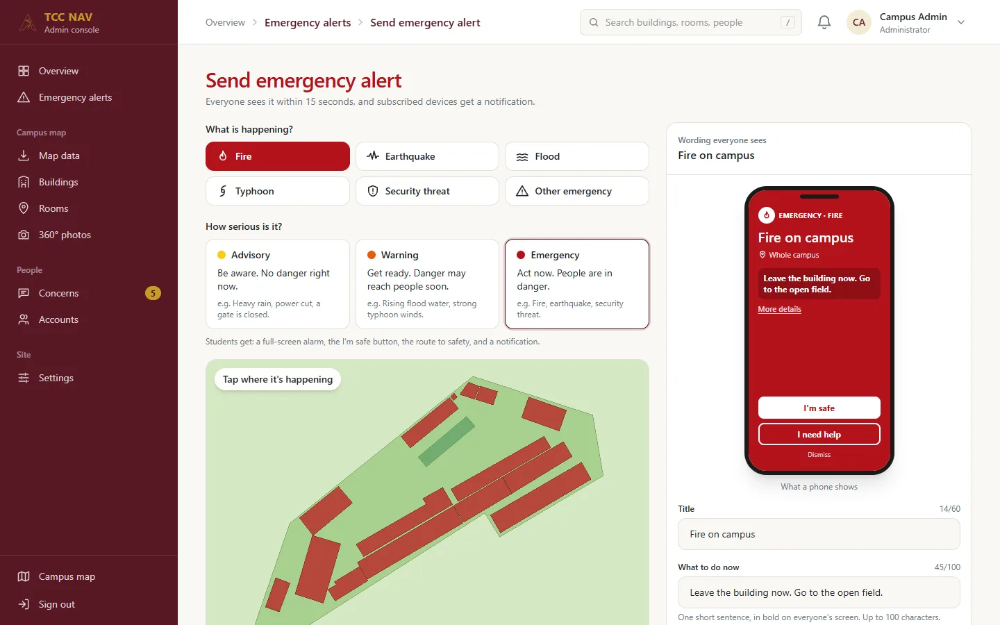<br>Admin: Send an alert, with a phone preview |
| 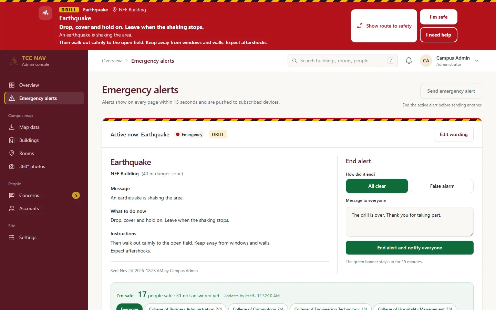<br>Admin: an active drill and the live "I'm safe" count | 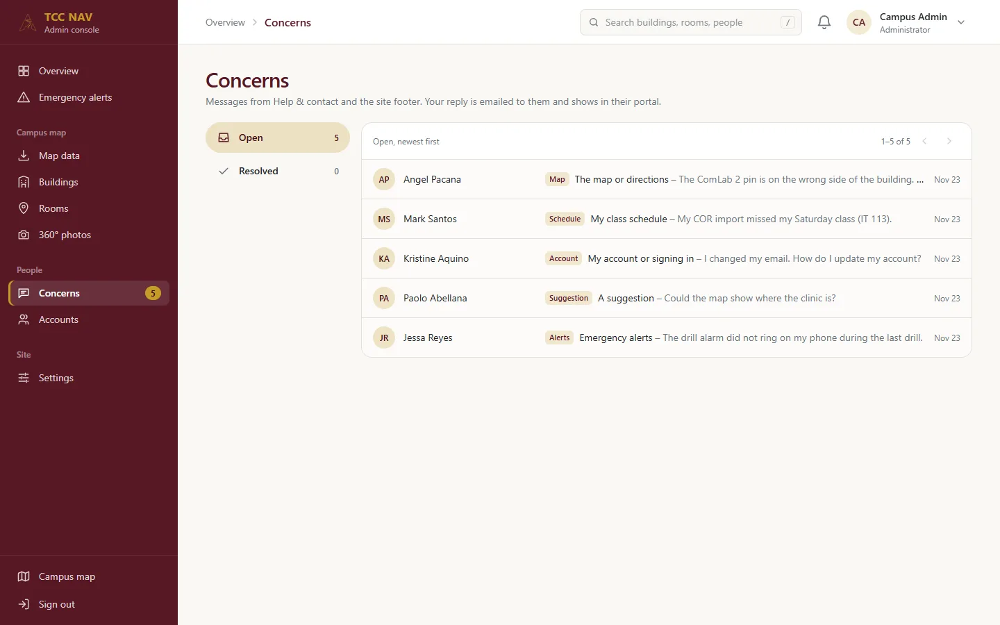<br>Admin: Concerns inbox |
| 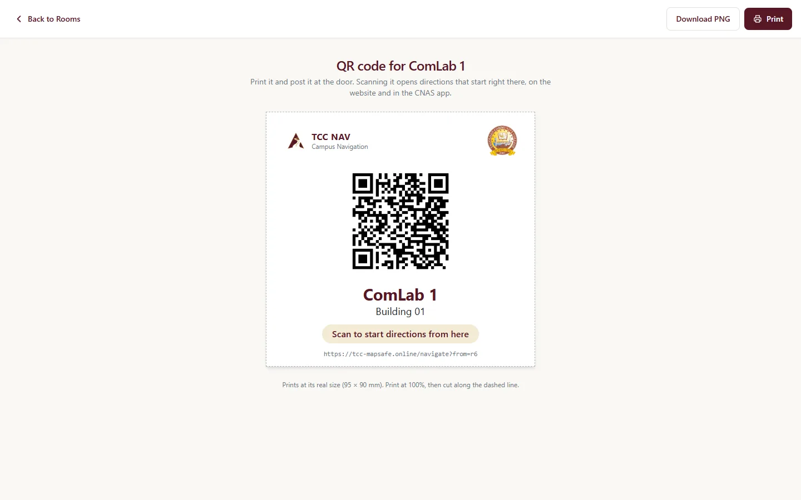<br>Admin: printable QR code for a room | |

**Mobile app**

| | | |
| --- | --- | --- |
| 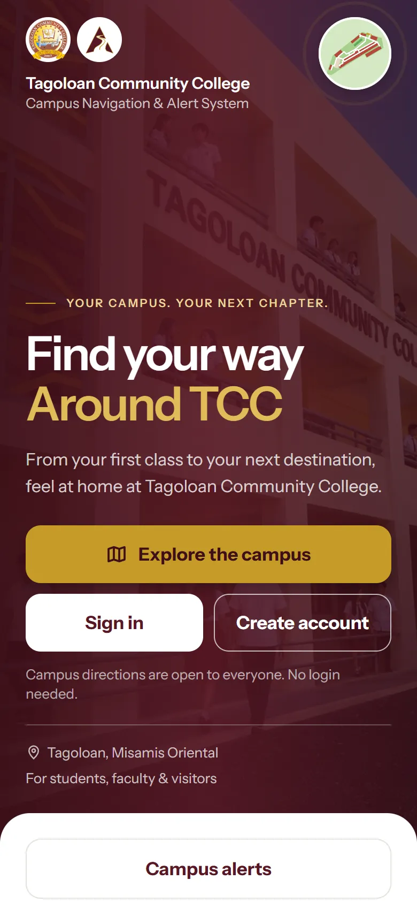<br>Welcome | 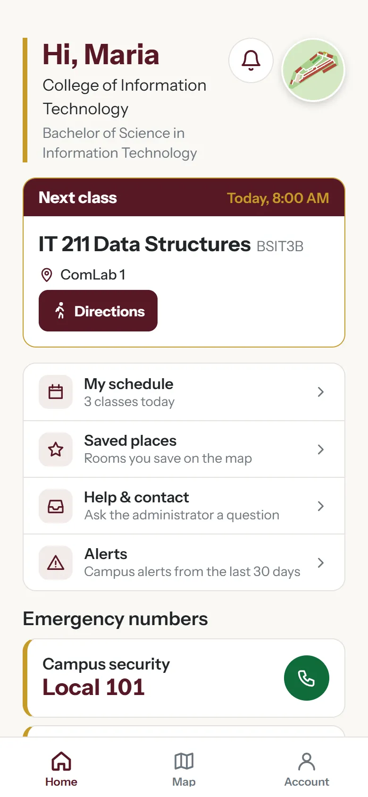<br>Home | 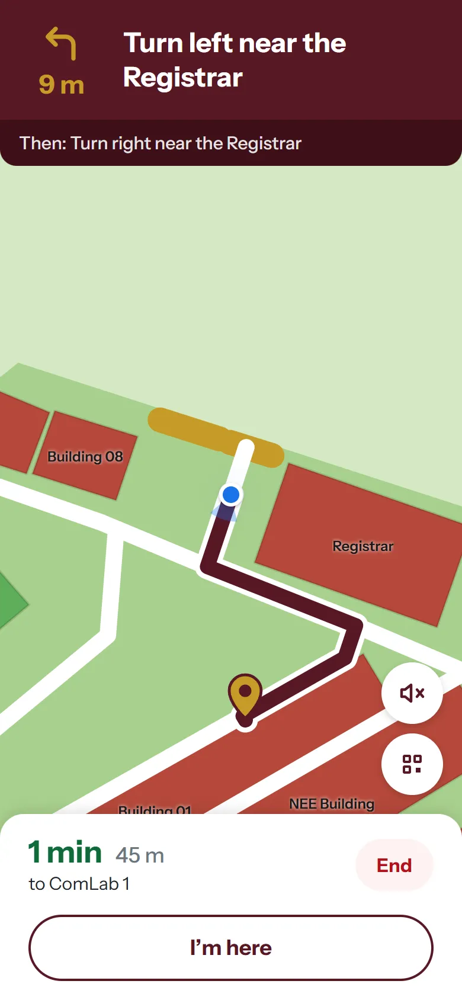<br>Walking navigation |
| 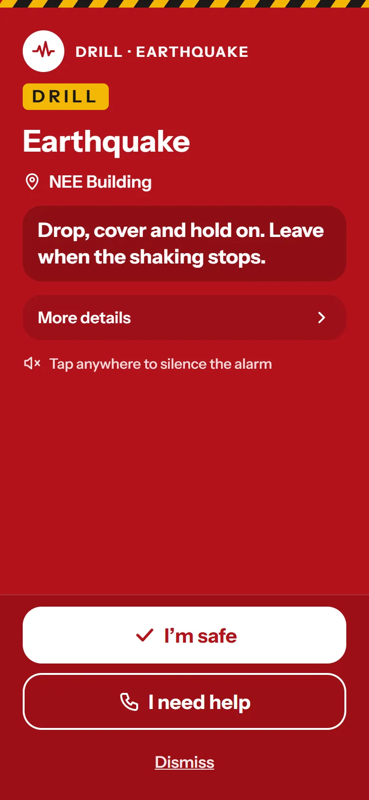<br>Emergency takeover | 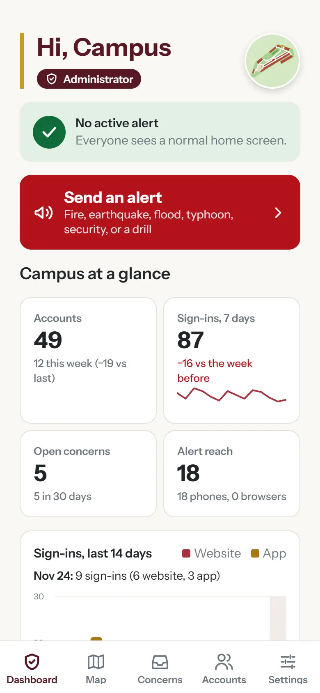<br>Admin: Dashboard | 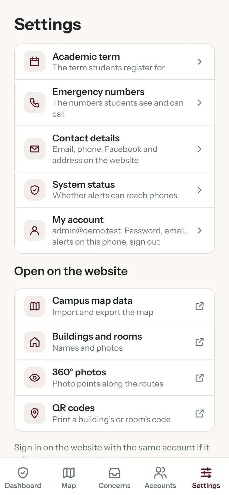<br>Admin: Settings |

## Features

**Navigation** (web and app)

- Turn-by-turn walking directions with a moving dot, from the Entrance Gate, "My location", a building or a QR code.
- Directions name the places students actually say ("near the Registrar"), not building codes.
- Rooms on upper floors route through the stairs first.
- The route is redrawn when you walk a different way. There is a "Next" button when GPS is too weak.
- Voice directions (off by default).
- Saved and recent places for signed-in users.
- During an emergency, "Show route to safety" goes around the danger zone.
- Web only: 360° photos along the route.

**Emergency alerts** (web and app)

- Types: fire, earthquake, flood, typhoon, security threat, other. Three levels: advisory, warning, emergency.
- Each alert can have a pin, a danger radius and the affected buildings. Drills are marked DRILL everywhere.
- An emergency takes over the screen with an alarm. People tap **I'm safe** or **I need help**, which can share
  their location.
- The admin sees a live count of who is safe, by college, plus the help requests.
- Alerts are delivered by Web Push (browsers) and Expo Push (the app), and show on every open page within 15
  seconds.
- Each alert ends as "All clear" or "False alarm". History and per-alert reports are kept.

**Portal** (students, faculty, staff; web and app)

- Sign-up by uploading the Certificate of Registration (COR). The PDF is read and checked, then thrown away.
- Email verification, sign-in by school ID or email, and forgotten password codes.
- My schedule from the COR or added by hand, a "Next class" card with directions, and My classes for faculty.
- Help & contact: send a concern and read the administrator's reply. Also a notification bell and settings.

**Admin console**

- Web and app: dashboard and analytics, emergency alerts, concerns inbox, accounts (create, edit, switch role,
  trusted alert senders, temporary passwords), the academic term, emergency numbers, contact details and system
  status.
- Web only:
  - campus map import and export (`campus.geojson`, edited in a GIS app)
  - building and room names and photos
  - 360° photos
  - printable QR codes for rooms and buildings
  - search across the admin console

## Architecture

CNAS is a **Laravel monolith with a mobile client**, kept in one repository:

- `CNAS-web` is the whole server: the website (Blade pages), the JSON API, the business rules, the database and the
  background jobs.
- `CNAS-mobile` is an Expo app. It has no server of its own and talks only to CNAS-web's `/api`.
- Route finding runs on the device, not on the server. The navigation engine is plain JavaScript in
  `CNAS-web/resources/js/navigation`. The website loads it directly, and the app imports the same files through
  Metro (`@nav/…`), so both give the same directions.

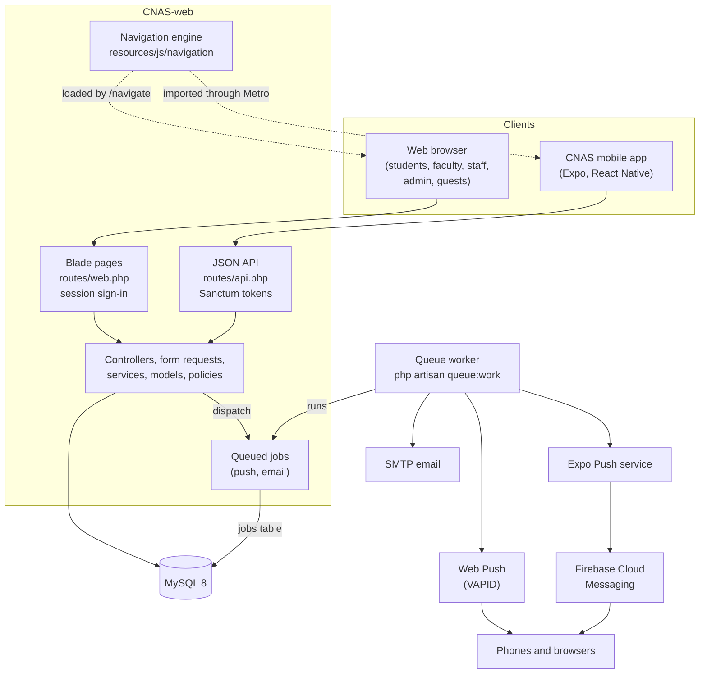

**Main layers in CNAS-web**

| Layer | What it does | Where |
| --- | --- | --- |
| Routes | Web pages, the `/api` for the app, scheduled tasks | `routes/web.php`, `routes/api.php`, `routes/console.php` |
| Controllers | Thin: read the request, call a service, return a view or JSON | `app/Http/Controllers` (`Admin`, `Portal`, `Api`, `Auth`) |
| Form requests | Validation and authorization for every form and API call | `app/Http/Requests` |
| Services | The business rules, shared by the web and the API (COR reading, alerts, safety summary, accounts, map import) | `app/Services` |
| Models and enums | Eloquent models, alert types and levels, roles | `app/Models`, `app/Enums` |
| Policies | Who may see or change what (e.g. only your own schedule) | `app/Policies` |
| Jobs and notifications | Web Push, Expo Push and its receipts, admin reports, email | `app/Jobs`, `app/Notifications`, `app/Mail` |
| API resources | The JSON the app receives | `app/Http/Resources` |
| Views and front end | Blade, Tailwind, vanilla JS modules, MapLibre | `resources/views`, `resources/css`, `resources/js` |

**Why a monolith**

- **One codebase and one database.** Accounts, alerts, schedules and the map live in one place.
- **The same rules for the web and the app.** The API controllers call the same services, form requests and
  policies as the web pages, so a rule changes in one place.
- **Simple to host.** One PHP app, one MySQL database, a queue worker and a cron entry. That fits ordinary shared
  hosting or a small VPS; no separate backend services are needed.

**One emergency alert, end to end**

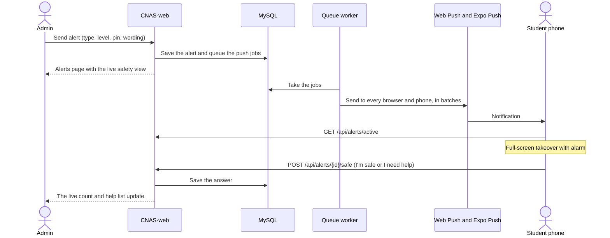

Open pages that miss the push still show the alert, because they check `/api/alerts/active` every 15 seconds.

## Tech stack

| Part | Technology | Version |
| --- | --- | --- |
| Server | PHP | 8.3 |
| Framework | Laravel | 13.39 |
| API sign-in | Laravel Sanctum | 4.3 |
| Database | MySQL (SQLite in tests) | 8.4 |
| Queue | Laravel database queue | n/a |
| Browser push | laravel-notification-channels/webpush (minishlink/web-push) | 13.0 (11.0) |
| COR reading | smalot/pdfparser | 2.13 |
| QR codes | chillerlan/php-qrcode | 5.0 |
| Web styling | Tailwind CSS | 4.3 |
| Web build | Vite with laravel-vite-plugin | 8.3 / 3.2 |
| Web maps | MapLibre GL JS | 5.24 |
| Geometry | Turf.js modules | 7.4 |
| 360° photos | Photo Sphere Viewer | 5.15 |
| Mobile | Expo SDK | 58 |
| Mobile UI | React Native / React | 0.88 / 19.3 |
| Mobile routing | Expo Router | 58 |
| Mobile language | TypeScript | 6.0 |
| Mobile map | react-native-svg | 15.16 |
| Phone push | Expo Notifications with Firebase Cloud Messaging | 58.1 |

## Repository layout

```
CNAS/
├── README.md               this file
├── docs/screenshots/       pictures used in this README
├── CNAS-web/               the Laravel monolith (website + API)
│   ├── app/                controllers, requests, services, models, enums, jobs, policies
│   ├── bootstrap/          app bootstrap (middleware, exceptions)
│   ├── config/             configuration, read from .env
│   ├── database/           migrations, seeders, factories, data/maps (the campus map seed)
│   ├── docs/               feature notes: decisions, where the code is, gotchas
│   ├── public/             web root (built assets, service worker, icons)
│   ├── resources/          Blade views, CSS, JS (resources/js/navigation is shared with the app)
│   ├── routes/             web.php, api.php, console.php (scheduled tasks)
│   └── tests/              PHPUnit (Feature, Unit) and Node tests for the JS (tests/js)
└── CNAS-mobile/            the Expo app
    ├── src/app/            screens (Expo Router): welcome, sign-in, portal/, admin/, navigate
    ├── src/components/     screen parts: alerts, navigation, admin, portal
    ├── src/lib/            API client, session, alerts, push, schedule, navigation session
    ├── assets/             images and sounds
    └── app.config.js, eas.json, metro.config.js   build and bundler settings
```

## Getting started (local)

You need PHP 8.3 with Composer, Node.js, and MySQL 8. Laragon on Windows works.

**Website and API (`CNAS-web`)**

```bash
cd CNAS-web
composer install
npm install
cp .env.example .env          # set DB_*, ADMIN_USERNAME/EMAIL/PASSWORD, MAIL_*
php artisan key:generate
php artisan webpush:vapid     # once; never change the keys afterwards
php artisan migrate
php artisan db:seed --class=CollegeSeeder
php artisan db:seed --class=ProgramSeeder
php artisan db:seed --class=AcademicTermSeeder
php artisan db:seed --class=AdminSeeder
php artisan db:seed --class=CampusMapSeeder
php artisan db:seed --class=EmergencyContactSeeder
php artisan storage:link
```

Run only the named seeders. A plain `php artisan db:seed` also creates a test account with a known password.

Then start these three, each in its own terminal:

```bash
php artisan serve --host=0.0.0.0 --port=8000   # reachable from a phone on the same Wi-Fi
php artisan queue:work --tries=3               # push alerts and emails need this
npm run dev                                    # Vite
```

`composer run dev` starts all three at once. More web notes, including the Windows OpenSSL setting for push, are in
[CNAS-web/README.md](CNAS-web/README.md).

**Mobile app (`CNAS-mobile`)**

```bash
cd CNAS-mobile
npm install
cp .env.example .env          # EXPO_PUBLIC_API_URL=http://<your PC's LAN IP>:8000 (no /api)
npx expo start --go           # Expo Go: everything except push notifications
npx expo start                # development build: needed for push alerts
```

Push alerts need a development build (EAS) and a Firebase project. The steps are in
[CNAS-mobile/README.md, "Push alerts"](CNAS-mobile/README.md#push-alerts).

## Testing

```bash
cd CNAS-web
php artisan test --compact    # PHPUnit: feature and unit tests
npm run test:js               # Node tests for the JS modules, including the shared navigation engine
vendor/bin/pint --test        # PHP code style

cd ../CNAS-mobile
npx expo lint                 # ESLint
npx tsc --noEmit              # TypeScript
```

## Deployment

The full checklist (server, `.env`, build, first run) is in
[CNAS-web/docs/deploy-review.md](CNAS-web/docs/deploy-review.md), section 4. In short:

- PHP 8.3, MySQL 8 and HTTPS. Push notifications and the service worker need HTTPS.
- `composer install --no-dev --optimize-autoloader`, `npm ci && npm run build`, `php artisan migrate --force`.
- **A queue worker must run 24/7** (Supervisor or the host's process manager). Without it, no push alert or email
  is sent. Restart it after each deploy with `php artisan queue:restart`.
- **Cron must run the scheduler every minute:** `* * * * * php /path/to/CNAS-web/artisan schedule:run`. It deletes
  "I'm safe" answers 30 days after an alert ends and sign-in history after 90 days (RA 10173), and it clears
  expired drafts and codes.
- The app is built with EAS and pointed at the site with `EXPO_PUBLIC_API_URL`.

## Documentation

Each feature has a short note in `CNAS-web/docs/`: the decisions, where the code is, and the gotchas.

- [accounts.md](CNAS-web/docs/accounts.md): Admin > Accounts, roles, trusted alert senders
- [alerts.md](CNAS-web/docs/alerts.md): emergency alerts, push, "I'm safe" and "I need help"
- [deploy-review.md](CNAS-web/docs/deploy-review.md): pre-deployment review and deployment checklist
- [map-data.md](CNAS-web/docs/map-data.md): buildings, paths, stairs, rooms, map import and export, photos
- [navigation.md](CNAS-web/docs/navigation.md): /navigate, routing, voice, tracking, 360° photos, QR codes
- [portal.md](CNAS-web/docs/portal.md): portal settings, account menu, breadcrumbs, notifications, saved places, concerns
- [registration.md](CNAS-web/docs/registration.md): COR registration, sign-in, email codes, password recovery, academic terms
- [schedule.md](CNAS-web/docs/schedule.md): My schedule, My classes, room matching, `/api/schedule`
- [search.md](CNAS-web/docs/search.md): the admin top bar search
- [settings.md](CNAS-web/docs/settings.md): admin settings, contact details, emergency numbers, system status

The app has its own guide: [CNAS-mobile/README.md](CNAS-mobile/README.md).

## Team

The project of IT 122, College of Information Technology, Tagoloan Community College.

- Rica Faith M. Bariga : Project Manager
- Kim V. Belco : QA
- Kieth Erickson S. Ladera : QA
- Domingo M. Galorport : Developer
- Clark Angelo C. Lagumbay : Developer
- Adviser: Sir Kent
